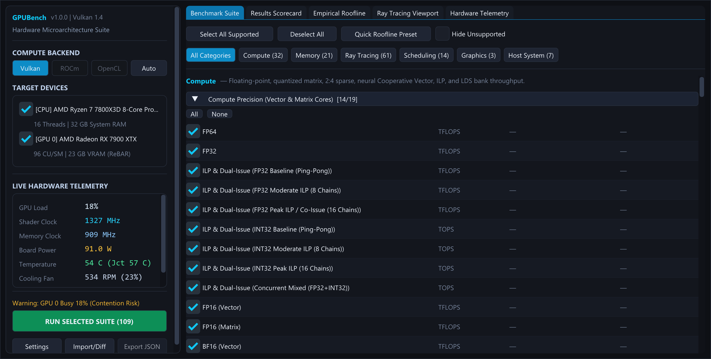
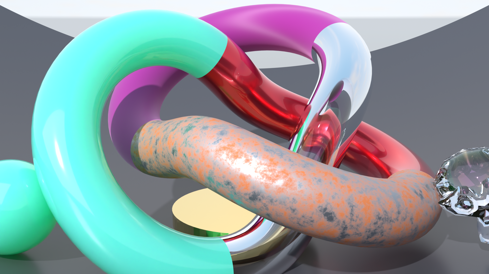
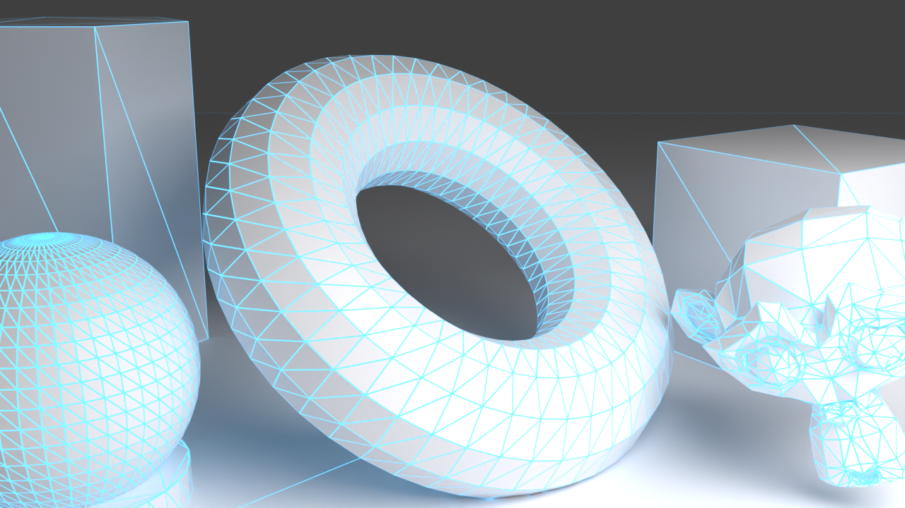
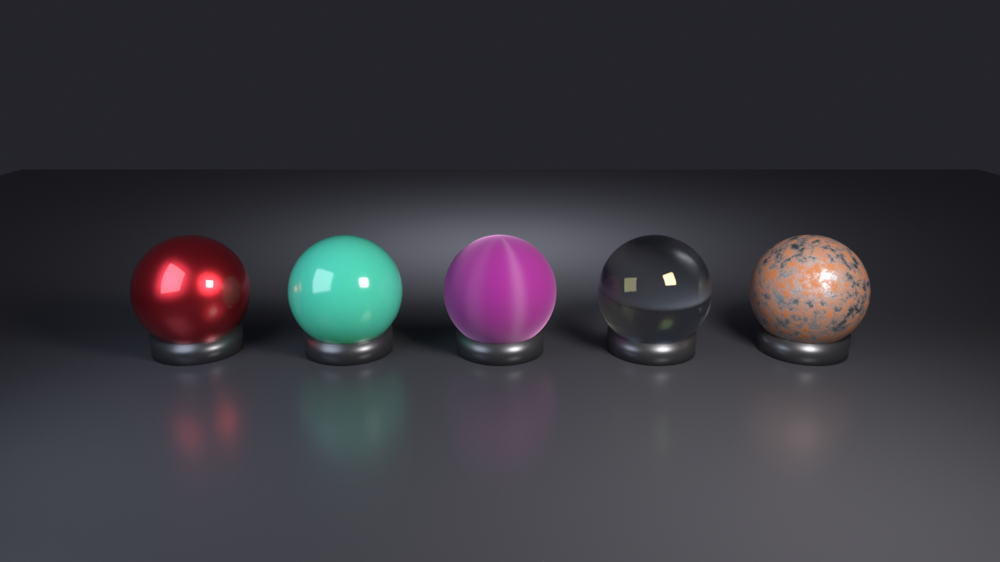
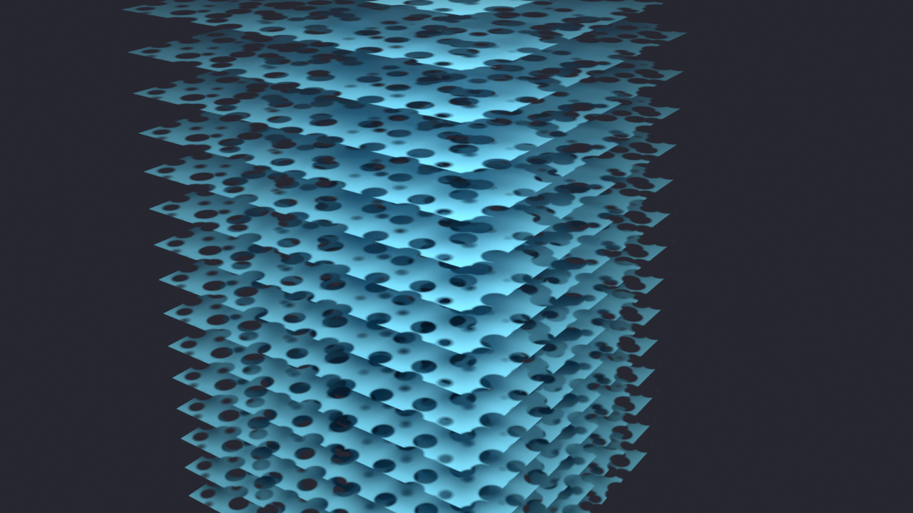

# GPUBench

GPUBench is a high-performance cross-platform GPU benchmarking tool designed to measure raw compute capabilities, memory bandwidth, and modern hardware ray tracing pipeline architectures across graphics hardware. It supports multiple backends and a wide range of data types, from double-precision floating point (FP64) down to 4-bit integers (INT4), alongside modern hardware ray scheduling architectures.


## Features

- **Multi-Backend Support**: Benchmarks using **Vulkan 1.4** (with **VulkanMemoryAllocator 3.5.0** & persistent disk-backed `VkPipelineCache`), **ROCm/HIP** (`hipGraphLaunch` stream capture + RDNA WMMA & CDNA MFMA), and **OpenCL 3.0**.
- **Hardware Ray Tracing & Next-Gen 2026 Microbenchmarks**:
  - **Ray Scheduling Architectures (`RayScheduling`)**: Megakernel vs. Decoupled Wavefronts via Device-Generated Commands (DGC), Persistent Workgroups (dynamically scaled by hardware CU/SM count), and Shader Execution Reordering (SER, where supported by hardware).
  - **Hardware Opacity Micromaps (`RayOMM`)**: Evaluates `VK_EXT_opacity_micromap` 2-state and 4-state hardware BVH micromap culling vs. AnyHit shader fallback on dense alpha-cutout geometry.
  - **GPU Work Graphs (`WorkGraphs`)**: Producer-to-consumer multi-node GPU work expansion via `VK_AMDX_shader_enqueue` (`SPV_AMDX_shader_enqueue`) compared against CPU/DGC indirect dispatch.
  - **Async Compute & Copy Engine Concurrency (`AsyncOverlap`)**: Quantifies standalone vs. concurrent Graphics/RT + Async Compute (`VK_QUEUE_COMPUTE_BIT` ACE) + DMA Copy Engine (`VK_QUEUE_TRANSFER_BIT`) execution overlap.
  - **Raw Hardware BVH Traversal (`RayRawTraversal`)**: Hardware BVH8 node traversal evaluating zero-overhead in-register ray queries (Coherent Triangles & 64-Layer `VK_GEOMETRY_TYPE_AABBS_KHR` Box Stress).
  - **Real-World Material & Spatial Ray Divergence (`RayDivergence`, `RayAnyHit`, `RayASBuild`, `RayPayload`)**: Heterogeneous PBR material shading, parametric cone divergence, 16-layer AnyHit cutout stacks, BLAS/TLAS build/refit throughput, and 16B–256B payload register pressure.
- **Comprehensive Compute, Structured Sparsity & Cooperative Vector**:
  - **Hardware Arithmetic & Tensor Types**: FP64, FP32, DualIssue (`VOPD` / concurrent FP32+INT32), FP16, BF16 (`VK_KHR_shader_bfloat16` & HIP `__hip_bfloat16` with automatic ISA emulation detection), FP8, INT8, INT4 (`gfx12+` sub-byte `iu4` WMMA & dynamic `(M, N, K)` Cooperative Matrix tile selection), and OCP Microscaling **MXFP6** (`Float6E3M2EXT`) / **MXFP4** (`Float4E2M1EXT`).
  - **2:4 Structured Sparsity (`SparseMatrix`) & Cooperative Vector (`CoopVector`)**: Evaluates 2:4 structured sparse tensor throughput vs. dense Cooperative Matrix baselines and `VK_NV_cooperative_vector` (`coopvecNV`) per-thread inference matmul+bias+ReLU kernels.
- **Memory, Cache Hierarchy & PCIe / ReBAR / Multi-GPU P2P Interconnect**:
  - **Device & Cache Hierarchy**: Device VRAM Bandwidth, L0/L1/L2/L3 Cache Bandwidth, L0 Cache Latency, and lazy per-tier cache latency curves (16 KB to 256 MB).
  - **Host-Device Interconnect (`Interconnect`) & Host SIMD (`SysMem`)**: Pinned-DMA Host-to-Device (`H2D`), Device-to-Host (`D2H`), full-duplex bidirectional `H2D+D2H`, ReBAR CPU->VRAM write bandwidth, APU unified-memory atomic coherency latency, Multi-GPU Peer-to-Peer (`P2P`), AVX-512 / AVX2 / ARM64 NEON non-temporal host streaming, and Windows/Linux 2 MB Large Pages.
- **Empirical Roofline Model & Cross-Platform Telemetry**:
  - **Empirical Roofline (`--roofline` & Interactive GUI Tab)**: Automatically derives peak DRAM/L2/L1/L0 bandwidth ceilings, vector/matrix compute ceilings, ridge points, and workload operational intensity (`FLOP/Byte`).
  - **Cross-Platform Hardware Telemetry**: Live GPU utilization, clocks, temperatures, VRAM, and package power across Windows (DXGI 1.4, WDDM PDH, AMD ADL2, NVIDIA NVML) and Linux (`amdgpu` `energy1_input` microjoule counters, Intel `xe`/`i915` hwmon, NVML), with explicit `"N/A"` reporting for unexposed sensors.
  - **Unified Typed JSON (`v2.0` via `yyjson`)**: Bidirectional session compatibility between `gpubench -o` / `--import` / `--compare` and `gpubench-gui`.

## Supported Backends

| Backend | Platform | Primary Use Case | Minimum Version |
| :--- | :--- | :--- | :--- |
| **Vulkan** | Linux, Windows | Primary cross-vendor compute, ray tracing, Work Graphs, OMM & GUI | **1.4+** |
| **ROCm/HIP** | Linux, Windows | Native AMD RDNA WMMA & CDNA MFMA compute + `hipGraphLaunch` | **6.4+** |
| **OpenCL** | Linux, Windows | Cross-vendor compute (`CL_TARGET_OPENCL_VERSION=300`) | **3.0** (1.2+ ICD) |

---

## Interfaces & Default Output

GPUBench provides both a standalone graphical workstation profiler built on a shared Vulkan 1.4 device (**Dear ImGui 1.93.0** dynamic glyph baking + **ImPlot v1.1**) and a rich command-line interface (**CLI11 v2.7.2**) with hierarchical Unicode reporting.

### Graphical User Interface (GUI)

The Workstation Profiler dashboard (`gpubench-gui`) shares its `VkInstance` and `VkDevice` directly with the Vulkan 1.4 compute engine—enabling zero-disk-roundtrip GPU VRAM ray tracing previews, real-time cross-platform telemetry charts, interactive log-log Empirical Roofline inspection, dynamic Ctrl+Scroll DPI zoom without `vkDeviceWaitIdle` stalls, and unified v2.0 JSON comparison:


*Fig: GPUBench Workstation Profiler GUI showing real-time hardware telemetry HUD, backend selection, Empirical Roofline & RT viewport tabs, and benchmark suite configuration.*

### Command-Line Interface (CLI)

Running `gpubench` in the terminal runs the preparation phase, compiles compute and ray tracing pipelines with an interactive ticker, and prints a hierarchical card report with throughput, memory latencies, and architectural speedup takeaways:

```text
$ gpubench -d 0

╭─ GPUBench v1.0.0 ─────────────────────────────────────────────────────────╮
│ Target Device : [GPU 0] AMD Radeon 8060S Graphics (RADV STRIX_HALO)        │
│ Backend / API : Vulkan | VRAM: 81 GB Unified Memory                        │
│ Resolution    : 3840x2160 (4K UHD)                                         │
╰────────────────────────────────────────────────────────────────────────────╯

  [1/2] Preparation Phase (compiling kernels, uploading data, building BVHs)...
  Progress: [━━━━━━━━━━━━━━━━━━━━━━━━━━━━] 100% Compiling pipelines
  ✔ Preparation complete.

  [2/2] Running Benchmarks...
  ✔ Benchmark suite completed.


  ╭─ GPUBench Hierarchical Benchmark Report ─────────────────────────────────────╮
  │ Target Device : AMD Radeon 8060S Graphics (RADV STRIX_HALO) (ID: 0)          │
  │ Canvas / Res  : 3840x2160 (4K UHD)                                           │
  ╰──────────────────────────────────────────────────────────────────────────────╯

  [Compute]
  ╭─ FP64 ───────────────────────────────────────────────────────────────────────╮
  │ Workload                                       │ Backend  │             Throughput │ Details / Speedup                       │
  ├────────────────────────────────────────────────┼──────────┼────────────────────────┼─────────────────────────────────────────┤
  │ FP64                                           │ Vulkan   │            0.43 TFLOPS │                                         │
  ╰────────────────────────────────────────────────┴──────────┴────────────────────────┴─────────────────────────────────────────╯
  ╭─ FP32 ───────────────────────────────────────────────────────────────────────╮
  │ Workload                                       │ Backend  │             Throughput │ Details / Speedup                       │
  ├────────────────────────────────────────────────┼──────────┼────────────────────────┼─────────────────────────────────────────┤
  │ FP32                                           │ Vulkan   │           18.38 TFLOPS │                                         │
  ╰────────────────────────────────────────────────┴──────────┴────────────────────────┴─────────────────────────────────────────╯
  ╭─ FP16 ───────────────────────────────────────────────────────────────────────╮
  │ Workload                                       │ Backend  │             Throughput │ Details / Speedup                       │
  ├────────────────────────────────────────────────┼──────────┼────────────────────────┼─────────────────────────────────────────┤
  │ Vector                                         │ Vulkan   │           24.37 TFLOPS │ [Baseline]                              │
  │ Matrix                                         │ Vulkan   │           54.66 TFLOPS │ └──> 2.24x (+124.3%)                    │
  ╰────────────────────────────────────────────────┴──────────┴────────────────────────┴─────────────────────────────────────────╯
  ╭─ INT8 ───────────────────────────────────────────────────────────────────────╮
  │ Workload                                       │ Backend  │             Throughput │ Details / Speedup                       │
  ├────────────────────────────────────────────────┼──────────┼────────────────────────┼─────────────────────────────────────────┤
  │ Vector                                         │ Vulkan   │             12.70 TOPS │ [Baseline]                              │
  │ Matrix                                         │ Vulkan   │             55.10 TOPS │ └──> 4.34x (+333.9%)                    │
  ╰────────────────────────────────────────────────┴──────────┴────────────────────────┴─────────────────────────────────────────╯

  [Memory]
  ╭─ Bandwidth ──────────────────────────────────────────────────────────────────╮
  │ Workload                                       │ Backend  │             Throughput │ Details / Speedup                       │
  ├────────────────────────────────────────────────┼──────────┼────────────────────────┼─────────────────────────────────────────┤
  │ Read 128 threads/group                         │ Vulkan   │            202.30 GB/s │                                         │
  │ Write 128 threads/group                        │ Vulkan   │            124.91 GB/s │                                         │
  │ R/W 128 threads/group                          │ Vulkan   │            129.96 GB/s │                                         │
  │ Read 256 threads/group                         │ Vulkan   │            170.62 GB/s │                                         │
  │ Write 256 threads/group                        │ Vulkan   │            123.14 GB/s │                                         │
  │ R/W 256 threads/group                          │ Vulkan   │            129.40 GB/s │                                         │
  │ Read 1024 threads/group                        │ Vulkan   │            198.08 GB/s │                                         │
  │ Write 1024 threads/group                       │ Vulkan   │            170.15 GB/s │                                         │
  │ R/W 1024 threads/group                         │ Vulkan   │            148.24 GB/s │                                         │
  ╰────────────────────────────────────────────────┴──────────┴────────────────────────┴─────────────────────────────────────────╯

  [Ray Tracing]
  ╭─ Intersection Tests ─────────────────────────────────────────────────────────╮
  │ Workload                                       │ Backend  │             Throughput │ Details / Speedup                       │
  ├────────────────────────────────────────────────┼──────────┼────────────────────────┼─────────────────────────────────────────┤
  │ Ray-Triangle                                   │ Vulkan   │       3,396.69 MRays/s │                                         │
  │ Ray-Box                                        │ Vulkan   │       7,375.20 MRays/s │                                         │
  ╰────────────────────────────────────────────────┴──────────┴────────────────────────┴─────────────────────────────────────────╯

  ╭─ Executive Performance Summary & Architectural Takeaways ────────────────────╮
  │ • Wavefront Scheduling Speedup : 3.08x in PBR Ray Tracing [Indoor Atrium] (56.8 vs 18.5 MRays/s) │
  │ • Peak Measured Ray Rate        : 7,375.2 MRays/s (Ray-Box)                  │
  ╰──────────────────────────────────────────────────────────────────────────────╯
```

---

## Hardware Ray Tracing & Scheduling Architectures

Modern ray tracing performance in production games and visual effects engines is rarely bound by simple triangle intersection; it is bound by **divergence**—both spatial ray direction divergence and material shading divergence.

GPUBench evaluates how different GPU hardware architectures handle these workloads across distinct scheduling architectures:

1. **Traditional Megakernel**: Traces rays and evaluates all hit shading in a single compute pass. Suffering from the "convoy effect," a single complex material forces all lanes to allocate worst-case VGPRs and serializes execution over divergent SIMD branches.
2. **Traditional + SER (Shader Execution Reordering)**: Evaluates in-pipeline thread regrouping (`VK_EXT_ray_tracing_invocation_reorder`) on supported architectures (e.g. NVIDIA Ada Lovelace / Blackwell) to dynamically regroup divergent lanes by spatial direction and material hit ID before executing hit shaders. *(Note: Unsupported on AMD RDNA hardware, which relies on software stream compaction).*
3. **Device-Generated Commands (DGC / Wavefront Compaction)**: Compacts divergent hits into categorized material queues via ballot/atomic compaction and dispatches uniform waves using GPU-driven command generation (`VK_EXT_device_generated_commands`), providing optimal scaling across AMD RDNA and multi-vendor GPUs.

#### Four-Scenario Benchmarking Morphology
All scenario throughput measurements below were evaluated at **4K UHD (3840x2160, ~8.29M primary rays)** on the **AMD Radeon AI PRO R9700** (RDNA 4 / gfx1201):
- **Showroom Studio (`-s showroom`)**: $108,936$ triangles featuring the Khronos ToyCar glTF asset with clearcoat, decals, and velvet pedestal. Device-Generated Commands (DGC) achieve **101.3 FPS** vs. Megakernel **57.6 FPS** (**1.76x speedup**).
- **Complex Indoor Atrium (`-s indoor`)**: $426,064$ triangles featuring the Renaissance Colonnade Atrium glTF (`assets/models/sponza.glb`) with 25 PBR materials, open-air courtyard skylight, and two-story colonnade arcades. Device-Generated Commands (DGC) achieve **68.0 FPS** vs. Megakernel **30.5 FPS** (**2.23x speedup**).
- **Open-World Outdoor Landscape (`-s outdoor`)**: $57,216$ triangles spanning $>2000\text{m}$ alpine terrain, lake, conifer foliage, and Rayleigh-Mie atmospheric scattering. Device-Generated Commands (DGC) achieve **420.0 FPS** vs. Megakernel **185.8 FPS** (**2.26x speedup**).
- **Open-World Forest (`-s forest`)**: $1,051,696$ triangles featuring high-density 256×256 terrain, river bathymetry, 530 trees (350 pines, 180 birches), and 8 nature PBR shaders. Device-Generated Commands (DGC) achieve **55.0 FPS** vs. Megakernel **27.0 FPS** (**2.04x speedup**).
- **100% Bit-Exact Analytical Parity**: Verified bit-exact 120.00 dB PSNR, 0.000000 MAE, and 0 discrepant pixels across all 8,294,400 pixels at 4K UHD across all four scenarios.

---

### Realistic Material Divergence

Production scenes rarely contain uniform shaders; they feature a **heterogeneous distribution of materials** with differing computational complexity and register footprints.


*Fig 1: Representative still-life showroom scene featuring a heterogeneous distribution of production material archetypes.*


*Fig 2: Wireframe view showing the underlying geometry, mesh density, and topological curvature of the test scene.*

#### Reference Material Archetypes


*Fig 3: Lineup of production material candidates on test pedestals.*

| Archetype | Reference Shading Model | Computational / SIMD Bottleneck |
| :--- | :--- | :--- |
| **Clearcoat Car Paint** | Dual-specular GGX lobes (clearcoat + metallic substrate), Beer-Lambert absorption, high-frequency Voronoi micro-flake glints. | Multi-lobe evaluation, procedural hash functions, secondary normal perturbations. |
| **Dispersive Crystal / Glass** | Snell's law refraction with total internal reflection (TIR) branching, Cauchy spectral dispersion, 450 nm thin-film wave interference. | Directional ray branching (reflection vs. transmission), trigonometric Airy interference series. |
| **Organic Jade / Wax** | Multi-channel subsurface diffusion profile ($R, G, B$ differing mean free paths), dual-lobe surface gloss. | Multi-channel exponential attenuation, non-local volumetric scattering. |
| **Anisotropic Velvet / Fabric** | Dual-axis anisotropic roughness ($a_x \neq a_y$) with tangent frame rotation, Charlie micro-fiber inverted grazing sheen ($D_{\text{charlie}}$). | Tangent-space matrix transforms, transcendental power functions ($x^{1/2\alpha}$). |
| **Weathered Industrial Rust** | 6-octave Fractal Brownian Motion (FBM) noise loops, continuous dynamic phase transition from conductor steel to porous dielectric rust. | Heavy arithmetic loop execution, divergent multi-octave iteration depth. |
| **Matte Ceramic & Concrete** | Standard Lambertian/Oren-Nayar diffuse PBR. | Minimal ALU baseline, high wave occupancy. |

#### Analytic Atmospheric Skybox Model

When secondary rays escape geometric boundaries into the surrounding environment, GPUBench evaluates an algebraic Rayleigh-Mie atmospheric scattering model with Henyey-Greenstein solar aureole forward scattering:


*Fig 4: 360° equirectangular preview of the mathematical atmospheric sky model evaluated when rays miss geometry.*

Stressing arithmetic ALUs on miss without querying large VRAM texture maps ensures that BVH traversal and material divergence remain the dominant bottlenecks without cache pollution from texture filtering units.

---

### Geometry & BVH Traversal Benchmarks


*Fig 5: 16 stacked alpha-tested cutout planes used in the `RayAnyHit` benchmark to measure BVH AnyHit invocation overhead.*

* **Multi-Layer Alpha Testing (`RayAnyHit`)**: Measures hardware performance when traversing through transparent foliage and cutout surfaces. Tests BVH traversal with stochastic opacity cutouts across 16 stacked geometric planes.
* **Spatial Cone Ray Divergence (`RayDivergence`)**: Sweeps ray cone distribution angles from $\theta = 0^\circ$ (fully coherent primary rays) to $\theta = 90^\circ$ (fully diffuse hemispherical rays) to benchmark L1/L2 cache hit rates in GPU BVH traversal units.

---

## Quick Start

### Prerequisites

Ensure you have the appropriate drivers and SDKs installed for the backends you wish to use. See [VERSION_REQUIREMENTS.md](VERSION_REQUIREMENTS.md) for details.

### Installation

Download the latest release package (`.rpm`, `.deb`, `.tar.gz`) from the [GitHub Releases](https://github.com/Soddentrough/GPUBench/releases) page or build from source following the [INSTALL.md](INSTALL.md) guide.

### Basic Usage

```bash
# List all available benchmarks
gpubench --list-benchmarks

# List compute backend availability and diagnostic status
gpubench --list-backends

# Run all benchmarks on default device
gpubench

# Run Next-Gen 2026 Interconnect, Async Overlap, Work Graphs, Sparsity, CoopVec & OMM benchmarks
gpubench -d 0 -b interconnect,asyncoverlap,workgraphs,rayomm,sparsematrix,coopvector

# Run Empirical Roofline analysis across memory/cache & compute tiers and export unified v2.0 JSON
gpubench -d 0 -g compute,memory --roofline -o benchmark_results.json

# Import or compare unified v2.0 JSON reports (compatible between CLI and gpubench-gui)
gpubench --import benchmark_results.json --roofline
gpubench --compare baseline.json candidate.json

# Run Dual-Issue & Concurrency benchmark suite across backends
gpubench -d 0 -b dualissue
gpubench -d 0 -b dualissue -k vulkan,rocm

# Select benchmark scene morphology: showroom, indoor, outdoor, forest, or all
gpubench -d 0 -b rayscheduling -s indoor -r 4k --verify-parity

# Run specific config (e.g. Config 9: Megakernel, Config 11: DGC, Config 25: Dynamic Persistent) in profiling snapshot mode
gpubench -d 0 -b rayscheduling -s forest -c 11 --profile-snapshot
```

### Hardware ISA Disassembly & Profiling

GPUBench includes built-in hardware ISA disassembly (`VK_KHR_pipeline_executable_properties` & `llvm-objdump`), live compiler statistics, and Radeon Raytracing Analyzer (`.rra`) capture support:

```bash
# Inspect hardware ISA, instruction histograms, hot-loop disassembly, and VGPR/SGPR usage
gpubench --dump-isa bf16
gpubench --dump-isa workgraphs
gpubench --dump-isa rayomm
gpubench --dump-isa dualissue --full-isa
gpubench --dump-isa fp16 -k rocm

# Capture a single-frame profiling snapshot or RRA ray tracing trace
gpubench -d 0 -b rayscheduling -s indoor -c 11 --profile-snapshot
gpubench -d 0 -b rayscheduling -s indoor -c 11 --rra
```

## Documentation

### Core Guides
- [Installation Guide](INSTALL.md) - Cross-platform build and installation instructions.
- [Windows Packaging Guide](packaging/windows/README.md) - Windows build and installer packaging instructions.
- [Version Requirements](VERSION_REQUIREMENTS.md) - Minimum software and compute hardware requirements.
- [Release Process](RELEASING.md) - Tagging, CI packaging, and automated release deployment.

### Architectural & Technical Whitepapers
- [Ray Scheduling Architectures](docs/RAY_SCHEDULING_ARCHITECTURE.md) - Decoupled scheduling, microarchitectural ISA analysis, and RGP timeline profiling.
- [RDNA 4 Ray Tracing Architecture](docs/RDNA4_RAY_TRACING_ARCHITECTURE.md) - RAv3 BVH8 traversal, LDS hardware stack management, and DGC wavefront compaction.
- [RDNA 3 Ray Tracing Architecture](docs/RDNA3_RAY_TRACING_ARCHITECTURE.md) - Chiplet topology, memory fabric, and zero-LDS pure Wave32 compaction.
- [Hardware Profiling & Telemetry Guide](docs/PROFILING_GUIDE.md) - Native ISA disassembly (`--dump-isa`), ACO compiler stats, packet dumping, and SMI telemetry.
- [Dual-Issue & Datapath Concurrency](docs/DUAL_ISSUE_ANALYSIS.md) - RDNA 3 VOPD, RDNA 4 dual-issue SIMD32, and NVIDIA concurrent FP32+INT32 datapath analysis.
- [OpenCL Backend](docs/OPENCL_BACKEND.md) - Architecture, feature matrix, and disk binary caching.
- [Tooltip Visualizations](docs/TOOLTIP_VISUALIZATIONS.md) - Three-tier hover-tooltip visualization architecture for graphics and ray tracing workloads.

## License

This project is licensed under the MIT License - see the [LICENSE](LICENSE) file for details.
